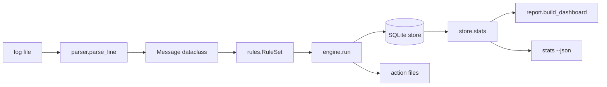

# syslog-router

[](https://github.com/jeremydacosta-TechOptimist/syslog-router/actions/workflows/ci.yml)


Parse, route, store and report syslog messages from the command line: a standard-library-only
pipeline for lab and production logs.

Network devices and servers emit syslog at very different levels of structure. `syslog-router`
turns that stream into something queryable: it parses RFC 5424, RFC 3164 and Cisco-style lines,
filters events through ordered JSON rules, keeps the result in SQLite and renders a standalone
HTML dashboard. It runs offline, without a daemon, a database server or any third-party package.

## Features

- RFC 5424 parser: PRI, version, RFC 3339 timestamps with `Z` or numeric offsets, structured
  data with `\"`, `\\` and `\]` escapes, BOM stripping, nil values and UTF-8 messages.
- RFC 3164 parser: `Mmm dd hh:mm:ss` timestamps (year inferred from the reference time), tags
  with and without `[pid]`, plus a documented lenient fallback for lines without a header.
- Cisco IOS-style log lines: optional clock prefix and sequence number, with the
  `%FACILITY-SEVERITY-MNEMONIC` token mapped to application name and message id.
- Ordered JSON routing rules: host/application globs, facility names or numbers, `severity_max`,
  regular expressions, `store`/`drop`/`stop`, per-rule counters and action files.
- Rule validation that reports every schema, facility and regular-expression error with the
  index and name of the offending rule.
- SQLite store with schema versioning, running counters, severity/host/application/per-minute
  statistics and retention pruning against an injectable clock.
- Standalone HTML dashboard: inline CSS, no JavaScript, no external assets, everything escaped.
- CLI with `parse`, `run`, `stats`, `report`, `rules validate` and `version`, `--json` output
  and documented exit codes (0 success, 1 runtime or validation error, 2 usage error).
- Deterministic lab fixtures under `examples/`, so every demo and test works offline.

## Quick start

```console
$ git clone https://github.com/jeremydacosta-TechOptimist/syslog-router.git
$ cd syslog-router
$ pip install -e .
$ syslogrouter version
syslogrouter 1.0.0
```

Python 3.10 or newer is required. `python -m syslogrouter` is equivalent to the installed
`syslogrouter` console script.

## Usage

### Parse one message

```console
$ syslogrouter parse "<34>1 2003-10-11T22:14:15.003Z mymachine.example.com su - ID47 - 'su root' failed for lonvick on /dev/pts/8"
format     rfc5424
pri        34
facility   4 (auth)
severity   2 (crit)
timestamp  2003-10-11T22:14:15.003000Z
hostname   mymachine.example.com
app_name   su
proc_id    -
msg_id     ID47
structured -
msg        'su root' failed for lonvick on /dev/pts/8
```

`parse --json` prints the same fields as a JSON document, and `parse --stdin` accepts one
message per line, which is convenient when piping a log excerpt.

### Route and store a lab log

`examples/lab-logs/mixed.log` contains 30 deterministic lab events (RFC 5424, RFC 3164,
Cisco-style and one headerless line). `examples/lab-rules.json` defines five ordered rules:
count SSH failures, copy firewall denies to a file, count emergencies and alerts, count cron
jobs, and drop chatty `DEBUG` lines from the `app` application.

```console
$ syslogrouter rules validate examples/lab-rules.json
rules OK: 5 rules in examples/lab-rules.json
$ syslogrouter run --input examples/lab-logs/mixed.log --rules examples/lab-rules.json --db out/lab.db --now 2026-03-02T00:00:00Z
input        examples/lab-logs/mixed.log
lines        30
parsed       30
parse errors 0
stored       26
dropped      4
counters
  auth_failures    4
  crit_alerts      2
  cron_jobs        3
  firewall_denies  4
  unmatched        13
files
  out/denied-events.log  4 lines
```

`--now` pins the reference clock so RFC 3164 year inference and timestamp-less lines are
reproducible. Use `--no-keep-unmatched` to discard events that match no rule, `--prune-days N`
to delete old events after the run, and `--json` for a machine-readable run report.

Exit codes: `0` success, `1` runtime or validation error, `2` usage error.

### Inspect and report

```console
$ syslogrouter stats --db out/lab.db --top 5
database   out/lab.db
events     26
window     2026-03-01T22:14:15.003000Z .. 2026-03-02T00:00:00.000000Z
severity
  emerg    1
  alert    1
  crit     2
  err      1
  warning  1
  notice   9
  info     10
  debug    1
counters
  unmatched        13
  auth_failures    4
  firewall_denies  4
  cron_jobs        3
  crit_alerts      2
top hosts
  db-srv-01.example    6
  auth-srv-01.example  5
  core-sw-01.example   5
  fw-edge-01.example   4
  lab-monitor.example  2
top apps
  sshd        5
  CRON        3
  trafficmon  3
  kernel      2
  link        2
per-minute rates
  2026-03-01T22:14  3
  2026-03-01T22:15  3
  2026-03-01T22:16  1
  2026-03-01T22:17  2
  2026-03-01T22:18  5
  2026-03-01T22:19  4
  2026-03-01T22:20  3
  2026-03-01T22:21  1
  2026-03-01T22:22  2
  2026-03-02T00:00  2
$ syslogrouter report --db out/lab.db --out out/dashboard.html --now 2026-03-02T00:00:00Z
wrote dashboard out/dashboard.html (26 events)
```

The dashboard is a single HTML file with summary cards, CSS severity bars, top hosts and
applications, counter totals and the most recent events. `stats --json` returns the same
statistics as JSON.

## Architecture



`parser.py` converts one raw line into a `Message` and never trusts the input: unknown formats
fall back to a lenient record instead of crashing the run. `rules.py` loads the ordered rule set
and exposes matching; `engine.py` applies every matching rule in order, keeps the counters and
the store/drop decision, and writes action files. `store.py` owns the SQLite schema, the
statistics queries and retention pruning. `report.py` renders the dashboard from the same
statistics object the CLI prints, so text and HTML output never disagree. `cli.py` only parses
arguments, formats output and maps failures to exit codes.

## Project layout

```text
syslog-router/
├── .github/workflows/ci.yml
├── .gitignore
├── LICENSE
├── README.md
├── pyproject.toml
├── examples/
│   ├── README.md
│   ├── lab-logs/mixed.log
│   └── lab-rules.json
├── src/syslogrouter/
│   ├── __init__.py
│   ├── __main__.py
│   ├── cli.py
│   ├── engine.py
│   ├── parser.py
│   ├── report.py
│   ├── rules.py
│   └── store.py
└── tests/
    ├── test_cli.py
    ├── test_engine.py
    ├── test_examples.py
    ├── test_package.py
    ├── test_parser.py
    ├── test_report.py
    ├── test_rules.py
    └── test_store.py
```

## Testing

The whole suite is `unittest.TestCase`, so it runs under both pytest and unittest, and it never
touches the network or leaves files behind (temporary directories are used everywhere).

```console
$ $env:PYTHONPATH = "src"
$ py -3.13 -m pytest -q
318 passed, 223 subtests passed in 16.80s
$ python -m unittest discover -s tests
Ran 318 tests in 16.424s

OK
$ python -m compileall -q src tests
```

Coverage includes RFC 5424 section 6.5 sample messages, PRI and timestamp edge cases, structured
data escapes and malformed structured data, RFC 3164 variants, Cisco-style prefixes, the lenient
fallback, rule matching and validation errors, store roundtrips and pruning with an injected
clock, engine counters and stop handling, HTML escaping with a `<script>` sample, and every CLI
subcommand through an in-process `main()` with captured stdout/stderr and exit codes.

## Roadmap

- Add a `tail --follow` mode that incrementally reads a growing file instead of a full run.
- Add an optional RFC 5425 TLS listener as an ingestion front end, keeping the parser unchanged.
- Export statistics as CSV and Prometheus text format for external dashboards.
- Support per-rule severity overrides and sampling actions for very noisy sources.

## Resumo em português (PT-PT)

- `syslog-router` analisa mensagens RFC 5424, RFC 3164 e linhas no estilo Cisco, sem qualquer dependência externa e apenas com a biblioteca padrão do Python.
- As regras de encaminhamento são uma lista JSON ordenada, com validação detalhada e ações de armazenamento, contagem, ficheiro de saída ou descarte.
- Os eventos ficam numa base SQLite com contadores, estatísticas por severidade, host, aplicação e minuto, além de retenção por número de dias.
- A CLI oferece `parse`, `run`, `stats`, `report`, `rules validate` e `version`, com saída JSON e códigos de saída documentados.
- O dashboard HTML é autónomo, e as fixtures de laboratório em `examples/` tornam todas as demonstrações e testes reproduzíveis offline.

## License

MIT © 2026 Jeremy da Costa — see [LICENSE](LICENSE).
